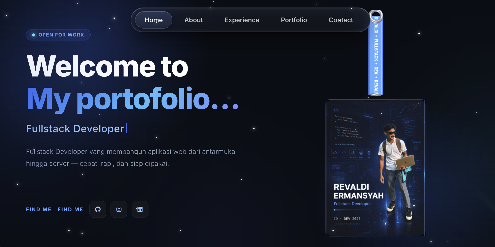

# Portofolio Revaldi Ermansyah
 
Website portofolio personal bertema **dark + neon** untuk seorang Fullstack Developer. Dibangun hanya dengan **HTML5, CSS, dan JavaScript** (tanpa framework), dengan **lanyard 3D interaktif** di bagian hero yang bisa ditarik, memantul, dan berayun seperti lanyard asli.

## Preview & Dokumentasi



 
## Fitur
 
- Loader persen dengan transisi naik saat selesai
- Background dengan orb biru dan efek meteor
- Navbar glass berbentuk pill, link aktif mengikuti scroll, menu mobile
- Hero dengan efek mengetik (typewriter)
- **Lanyard 3D (Three.js)**: tarik, lepas, kartu memantul lalu berayun. Dobel klik untuk membalik kartu
- Section About, Experience (pekerjaan, pendidikan, statistik), Portfolio (tab Proyek dan Skill), dan Contact
- Responsif untuk desktop dan HP
- Menghormati pengaturan `prefers-reduced-motion`
## Struktur Folder
 
```
portfolio-revaldi/
├── index.html      # struktur halaman
├── style.css       # seluruh styling
├── script.js       # loader, typewriter, navbar, tab, form
├── lanyard.js      # lanyard 3D (Three.js)
├── assets/
│   ├── front-card.webp   # tekstur sisi depan kartu
│   ├── back-card.webp    # tekstur sisi belakang kartu
│   └── strap.webp        # tekstur tali
└── README.md
```
 
## Menjalankan Secara Lokal
 
Lanyard memuat gambar sebagai tekstur WebGL, jadi halaman **harus dibuka lewat server lokal**. Kalau `index.html` dibuka langsung (`file://`), browser memblokir teksturnya.
 
Pilih salah satu:
 
```bash
# Python
python -m http.server 8000
 
# Node.js
npx serve .
```
 
Lalu buka `http://localhost:8000`. Di VS Code, ekstensi **Live Server** juga bisa dipakai.
 
## Kustomisasi
 
### 1. Data pribadi
Ubah teks langsung di `index.html`: nama, jabatan, pengalaman, pendidikan, proyek, skill, link sosial media, dan email.
 
### 2. Teks pada kartu lanyard
Atur lewat atribut di elemen `#lanyard` pada `index.html`:
 
```html
<div class="lanyard-card-container" id="lanyard"
     data-name="REVALDI ERMANSYAH"
     data-role="Fullstack Developer"
     data-email="revaldi@email.com"></div>
```
 
### 3. Tekstur kartu dan tali
Ganti file di folder `assets/` dengan nama yang sama:
 
| File | Fungsi | Saran ukuran |
|------|--------|--------------|
| `front-card.webp` | Sisi depan kartu | 1000 × 1500 px (rasio 2:3) |
| `back-card.webp` | Sisi belakang kartu | 1000 × 1500 px (rasio 2:3) |
| `strap.webp` | Tali lanyard | 160 × 1024 px |
 
Format `.png`, `.jpg`, dan `.jpeg` juga dikenali. Gambar dipas ke kartu tanpa gepeng (bagian lebih akan terpotong) dan sudutnya otomatis membulat. Kalau file tidak ditemukan, kartu memakai desain bawaan.
 
Untuk nama atau lokasi file lain, pakai atribut `data-front`, `data-back`, atau `data-strap`:
 
```html
<div id="lanyard" data-front="img/kartu-depan.png" data-back="img/kartu-belakang.png"></div>
```
 
### 4. Rasa fisika ayunan
Di `lanyard.js`, cari bagian fisika pendulum:
 
| Variabel | Fungsi |
|----------|--------|
| `G` | Gravitasi. Makin besar, ayunan makin cepat |
| `AIR` | Redaman. Makin kecil, ayunan makin lama berhenti |
| `BOUNCE` | Kuat pantulan saat tali menegang |
| `L` | Panjang tali |
| `MAXPULL` | Seberapa jauh tali bisa diregangkan saat ditarik |
 
### 5. Warna
Warna utama ada di `style.css`. Biru utama `#2c67ed`, aksen cyan `#00f0ff`, latar `#050510`.
 
### 6. Form kontak
Form saat ini masih demo (hanya menampilkan notifikasi). Sambungkan ke layanan seperti [Formspree](https://formspree.io) atau backend milikmu di `script.js`, bagian `contactForm`.
 
## Teknologi
 
- HTML5, CSS3, JavaScript (ES5)
- [Three.js](https://threejs.org) r128 via CDN cdnjs
- Font [Inter](https://fonts.google.com/specimen/Inter) via Google Fonts
## Deploy
 
Karena situs ini statis, bisa langsung di-deploy ke **GitHub Pages**, **Netlify**, **Vercel**, atau **Cloudflare Pages**. Tidak ada proses build, cukup unggah seluruh isi folder.
 
Untuk GitHub Pages: buka *Settings → Pages*, pilih branch `main` dan folder `/ (root)`.
 
## Catatan
 
- Perlu koneksi internet untuk memuat Three.js dan font dari CDN.
- Perlu browser dengan dukungan WebGL (semua browser modern).
- Tampilan CSS terinspirasi dari desain situs portofolio lain. Konten, nama, dan data di sini adalah milik pemilik portofolio ini.
## Lisensi
 
Silakan sesuaikan lisensi sesuai kebutuhanmu (misalnya MIT).
 